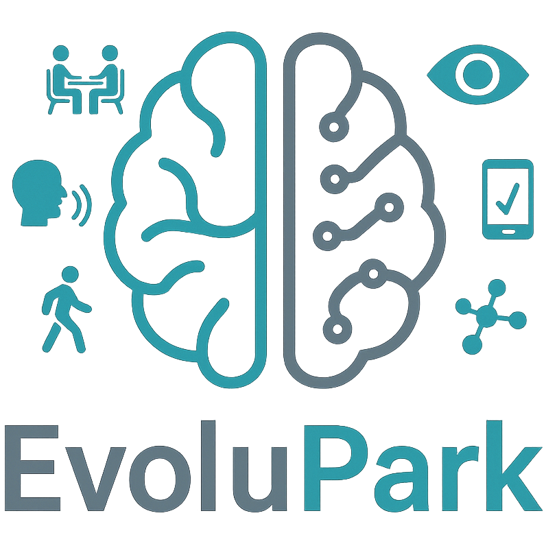

<!-- SPDX-FileCopyrightText: 2026 Gwenolé Quellec -->
<!-- SPDX-License-Identifier: MIT -->

# EvoluPark – Patient Journey

Python-based, YAML-driven animations explaining the **EvoluPark clinical study** and the patient journey.

<p align="center">
  
</p>

The project uses [Manim Community](https://www.manim.community/) for animation, SVG illustrations for characters and environments, and French text-to-speech narration generated with [Edge TTS](https://github.com/rany2/edge-tts) or [Piper TTS](https://github.com/OHF-voice/piper1-gpl).

Each YAML scenario is rendered as a narrated MP4 video using a shared animation engine. The goal is to create and update educational sequences without writing scene-specific Python code.

## Getting started

### Requirements

- Python 3
- FFmpeg and the system libraries required by Manim
- Python dependencies listed in `requirements.txt`

On Ubuntu, install the system dependencies if they are not already present:

```bash
sudo apt update
sudo apt install -y ffmpeg pkg-config build-essential \
    python3-dev python3-venv libcairo2-dev libpango1.0-dev
```

Create and activate the virtual environment, then install the Python dependencies:

```bash
python3 -m venv .venv
source .venv/bin/activate
python -m pip install -r requirements.txt
```

### Render a scenario

Pass the scenario name **without** its `.yaml` extension:

```bash
python engine/render.py inclusion
```

The scenario argument is **required**. The default render quality is **medium**.

```bash
python engine/render.py inclusion --low       # Fast preview (480p, 15 fps)
python engine/render.py inclusion --medium    # Standard preview (720p, 30 fps)
python engine/render.py inclusion --high      # Final render (1080p, 60 fps)
python engine/render.py --help
```

For `scenarios/inclusion.yaml`, the output is named **`inclusion.mp4`**, regardless of the Manim scene class name. Manim stores rendered files under `media/videos/` in a quality-dependent subdirectory, and the launcher opens the video after rendering.

The render command disables **Manim's animation cache** to avoid an audio-loss issue observed when re-rendering narrated scenes. Generated voice-over MP3 files are cached separately in `.cache/voice/` and reused when the narration text, voice and speech rate have not changed. The first synthesis of a narration requires an internet connection.

## Project structure

```text
engine/
  render.py             # CLI, scenario validation and Manim invocation
  scene.py              # Reusable YAML-driven animation engine
  voice.py              # Voice-over audio generation.
scenarios/
  inclusion.yaml        # Inclusion visit scenario
  ...                   # Other visits and home-based activities
assets/
  characters/           # SVG characters and poses
  furniture/            # SVG chairs, tables and other furniture
  backgrounds/          # Background illustrations
  logo/                 # EvoluPark branding
requirements.txt        # Python dependencies
LICENSE                 # License for original software
```

A scenario describes its narrative and visuals in YAML: styles, voice, characters and poses, furniture instances, spatial anchors, and ordered sequences of actions. The shared `EvoluParkScene` engine currently supports character entry, pose changes, sitting on a named chair, and displaying text. New activities (walking tests, handwriting assessments, questionnaires at home, etc.) can reuse the same engine as additional action types are implemented.

## Creating a scenario

1. Create a new file such as `scenarios/walking.yaml`, following the structure of `scenarios/inclusion.yaml`.
2. Reference SVG assets using paths relative to the project root.
3. Define sequences containing narration and supported actions.
4. Render it with `python engine/render.py walking --low`, then use `--high` for the final video.

For example, a character entry action can be expressed as:

```yaml
- character: neurologist
  pose: walking
  facing: left
  action: enter
  from: right
  to:
    x: 2.6
    bottom_y: -2.6
```

To use a new SVG pose, add its path to the corresponding character definition. The YAML `native_facing` property indicates the direction of the original artwork; the engine mirrors it when needed. For seated characters, fractional seat anchors align the character with a named chair.

## Credits and third-party artwork

This project incorporates and adapts illustrations from the following collections:

- **[Humaaans](https://www.humaaans.com/)** — created by **Pablo Stanley**. Used for characters, poses and some background elements. **License:** [CC0 1.0 Universal](https://creativecommons.org/publicdomain/zero/1.0/).
- **[FreeSVG](https://freesvg.org/)** — community-contributed SVG illustrations, including furniture and other scene objects. **License:** [CC0 1.0 Universal](https://creativecommons.org/publicdomain/zero/1.0/). See [FreeSVG's terms](https://freesvg.org/pages/terms-and-conditions).

Thanks to these creators and contributors for making their artwork available for reuse and adaptation. Attribution is not required under CC0, but is provided here in recognition of their work.

## License

The **original EvoluPark Python code, scripts and YAML scenarios** in this repository are released under the **MIT License** (see [`LICENSE`](LICENSE)), subject to the applicable ownership rights.

**Third-party SVG illustrations are not relicensed under MIT.** Humaaans and FreeSVG illustrations retain their CC0 status, including when recolored, rearranged or otherwise adapted for this project. Other assets, including logos or material from additional providers, may have separate rights and should be documented individually before redistribution.
